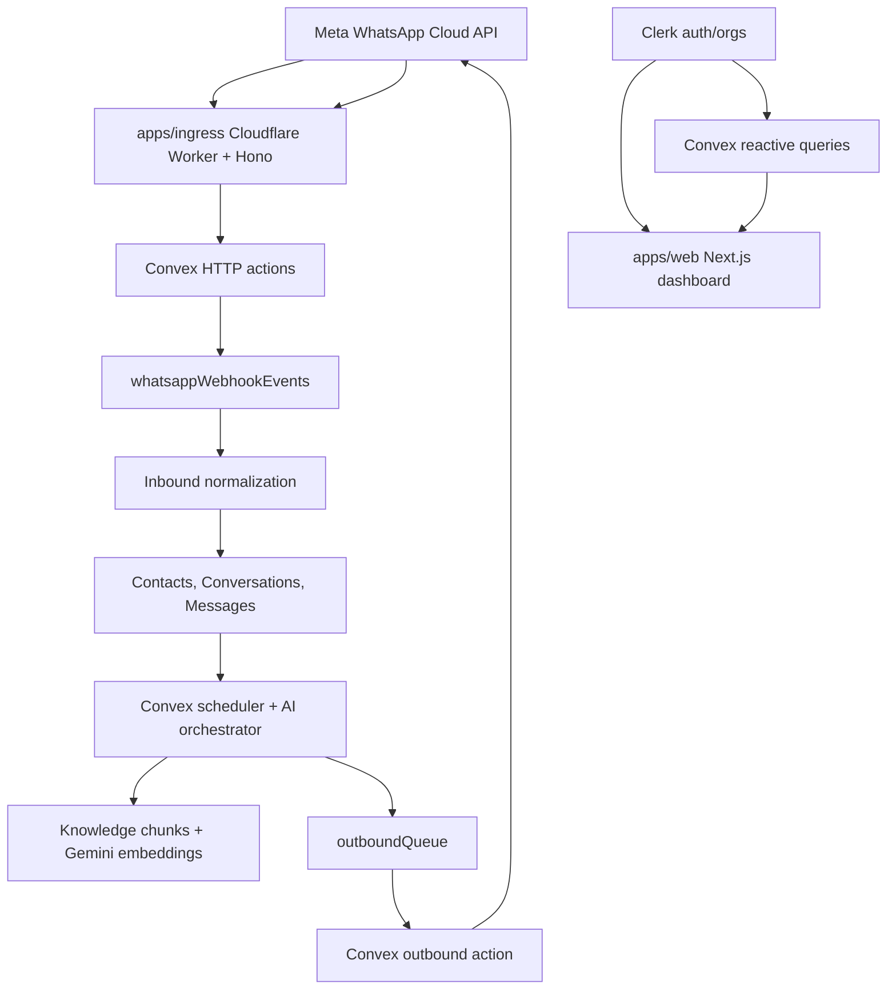

# Wabrix Stack Migration Assessment

## Purpose

This document evaluates the current Wabrix codebase against the proposed FlowDesk target stack and defines the most efficient migration path. The goal is not to rewrite everything blindly. The correct approach is to preserve the proven product/domain work, then replace only the platform-specific implementation layers that are tied to Convex, Clerk, Cloudflare Workers, and Next.js server APIs.

## Executive Summary

The current project is already a mature WhatsApp-first AI SaaS implementation. The business flow is substantially complete: tenant setup, bot configuration, knowledge ingestion, WhatsApp ingress, inbound normalization, conversation mapping, AI reply orchestration, outbound delivery, inbox operations, media processing, notifications, billing, usage limits, and analytics.

The proposed FlowDesk plan changes the infrastructure stack, not the product. The most efficient strategy is therefore:

1. Keep the monorepo, TypeScript domain logic, product flows, UI concepts, tests as behavioral references, copy, and design assets.
2. Replace Convex with PostgreSQL + Prisma, explicit service modules, BullMQ workers, and Socket.IO realtime.
3. Replace Cloudflare Worker/Hono ingress with Express ingress unless the worker is intentionally retained as an edge adapter.
4. Replace Clerk-dependent auth and organization context with JWT-based auth, refresh tokens, password hashing, and database-backed RBAC.
5. Keep Next.js temporarily if speed matters, but the target plan says React + Vite; migrate dashboard views into a Vite SPA after the backend contract is stable.

The highest-leverage reuse is the product/domain behavior, not the Convex function code as-is. Convex has compressed database, realtime, scheduler, queue, auth integration, and server functions into one platform. The new stack must split those responsibilities explicitly.

## Current Codebase Snapshot

### Repository Structure

- `apps/web`: Primary Next.js dashboard, localized with `next-intl`, using Clerk + Convex React hooks.
- `apps/web-2`: Larger dashboard/public-site experiment with richer UI, app shell, public docs, notification surfaces, and some Convex wiring.
- `apps/ingress`: Cloudflare Worker webhook ingress using Hono.
- `packages/backend`: Convex backend functions, schema, actions, scheduler-driven workflows, tests, and business logic.
- `packages/config`: Shared product constants, plan definitions, locales, and default bot prompts.
- `packages/ui`: Small shared React component package.
- `packages/eslint-config` and `packages/typescript-config`: Shared monorepo tooling.
- `docs/phase-*`: Phase implementation notes from product/spec through analytics and billing.

### Current Tooling

- Monorepo: `pnpm` workspaces + Turborepo.
- Language: TypeScript.
- Runtime requirement: Node.js `>=22`.
- Frontend: Next.js 16, React 19, Tailwind CSS 4.
- Backend platform: Convex.
- Auth: Clerk + Clerk Organizations.
- Ingress: Cloudflare Workers + Hono + Wrangler.
- AI: Vercel AI SDK, Google Gemini, OpenAI-compatible DigitalOcean reference endpoint.
- Billing: Polar + Midtrans.
- Tests: Vitest plus some Playwright setup.

## Current Runtime Architecture



The current system relies on Convex for four things that the target stack separates:

- Database persistence.
- Server function execution.
- Realtime query updates.
- Scheduling/background jobs.

That is the central migration problem.

## Target Stack From The FlowDesk Plan

The attached FlowDesk plan targets:

- Frontend: React + Vite + TypeScript + Tailwind + shadcn/ui.
- Backend API: Express.js + TypeScript.
- ORM/database: Prisma + PostgreSQL 16, with `pgvector` for RAG.
- Cache/queue/realtime broker: Redis 7.
- Jobs: BullMQ.
- Realtime: Socket.IO + Redis adapter.
- Auth: JWT access/refresh tokens, `argon2` password hashing.
- AI: OpenAI/Gemini provider adapter pattern.
- Deployment: Docker, Docker Compose, Nginx.
- CI/CD: GitHub Actions.
- Optional: Go ingress service for extra performance signal.

## What To Keep

### Keep Almost As-Is

These parts are already aligned with the target or are cheap to preserve:

- `pnpm` workspace and Turborepo structure.
- TypeScript-first development model.
- Shared config constants from `packages/config`, especially plan definitions and default bot prompt templates.
- Most presentational UI components and page copy from `apps/web` and `apps/web-2`.
- Public marketing/docs assets from `apps/web-2/public` and public route content.
- Existing Vitest test cases as behavioral specifications, even when the implementation underneath changes.
- Product documentation in `docs/phase-*` as a working source of truth for behavior.

### Keep With Adaptation

These parts are valuable, but they depend on Convex/Clerk/Next.js APIs and need wrappers or rewrites:

- Bot Studio logic: keep validation rules, prompt configuration fields, provider model settings, emulator behavior, AI run logging concepts.
- Knowledge Base logic: keep URL safety checks, markdown normalization, chunking, embedding model choice, source metadata, and retrieval behavior.
- WhatsApp integration logic: keep encrypted credential semantics, verify-token hashing, template sync concepts, lifecycle state, and frontend-safe redaction.
- Webhook ingestion logic: keep raw-body signature verification, event-key/idempotency design, event type derivation, rate-limit-by-phone-number behavior.
- Inbound processor: keep normalization, contact upsert, active conversation reuse, service window handling, media work creation, opt-in/opt-out handling.
- Bot orchestrator: keep debounce, service-window guard, bot pause/handoff/closed-conversation blocking, generation claim tokens, stale-generation checks.
- Outbound delivery: keep durable queue semantics, idempotency keys, retry classification, status reconciliation, template-vs-text payload distinction.
- Inbox actions: keep assignment, pause/resume bot, handoff, close/reopen, notes, manual replies, template replies, translation.
- Billing and usage limits: keep plan model, usage counters, billing event idempotency, Polar/Midtrans normalization, gateway-by-country strategy.
- Notifications: keep notification types, dedupe keys, read state, and web push behavior if browser notifications remain in scope.

### Use As Reference Only

These are too platform-specific to port line-by-line:

- Convex schema declarations in `packages/backend/convex/schema.ts`.
- Convex `query`, `mutation`, `action`, `internalMutation`, `internalAction`, and `scheduler.runAfter` call structure.
- Convex reactive client usage in React components.
- Convex storage upload URLs and `_storage` IDs.
- Clerk middleware, `ConvexProviderWithClerk`, `auth()`, `OrganizationSwitcher`, `UserButton`, and Clerk webhook sync.
- Cloudflare-specific `Bindings`, Wrangler config, and Cloudflare rate-limit binding.
- Next.js `app/api/*/route.ts` handlers if the frontend becomes a pure Vite SPA.

## What Must Change

### Backend Platform

Current:

- `packages/backend/convex/*` contains all backend behavior.
- Convex functions directly access `ctx.db`, `ctx.scheduler`, `ctx.storage`, and `ctx.auth`.
- Internal backend calls use `ctx.runMutation`, `ctx.runQuery`, and `ctx.runAction`.

Target:

- Create `apps/api` as an Express REST API.
- Create `apps/worker` as BullMQ consumers.
- Create `packages/db` for Prisma schema, migrations, generated client, and seed data.
- Create `packages/shared` for DTOs, Zod schemas, enums, and cross-service constants.
- Move reusable business rules into service modules that accept explicit dependencies: Prisma client, Redis client, queue producers, AI providers, object storage, and clock.

### Database

Current:

- Convex document tables with numeric timestamps.
- Application-enforced tenant scoping via Convex queries and `requireOrgContext`.
- Vector embeddings stored as `number[]` in `knowledgeChunks`.

Target:

- PostgreSQL relational schema through Prisma.
- Use UUID or CUID IDs consistently.
- Use `DateTime` fields instead of numeric millisecond timestamps unless there is a strong reason not to.
- Use relational foreign keys and composite indexes.
- Use `pgvector` for knowledge embeddings. Prisma support may need raw SQL migrations for vector columns/indexes.
- Enforce tenant isolation in service/repository layer and optionally PostgreSQL row-level security later.

### Auth And RBAC

Current:

- Clerk owns users, organizations, memberships, session state, and UI components.
- Convex auth derives active organization context from Clerk identity.

Target:

- Implement first-party auth tables: `users`, `organizations`, `organization_members`, `refresh_tokens` or `sessions`.
- Use `argon2` for password hashing.
- Use short-lived JWT access tokens and rotating refresh tokens.
- Add Express middleware for auth, organization context, and role checks.
- Replace Clerk UI components with internal account/org selector components.

### Queueing And Scheduling

Current:

- Convex scheduler triggers inbound processing, bot orchestration, service-window warnings, outbound sending, media processing, and lifecycle processing.

Target:

- Use BullMQ queues backed by Redis:
  - `whatsapp.inbound.normalize`
  - `bot.reply.generate`
  - `whatsapp.outbound.send`
  - `whatsapp.status.reconcile`
  - `whatsapp.media.process`
  - `whatsapp.templates.sync`
  - `billing.webhooks.process`
  - `notifications.dispatch`
- Keep durable database rows for raw events and outbound queue state. Redis/BullMQ should schedule and execute work, not become the only durable source of truth.

### Realtime

Current:

- Convex reactive queries update dashboard state automatically.

Target:

- Add Socket.IO server to `apps/api` or a separate realtime service.
- Emit tenant-scoped events after mutations/job completions.
- Use Redis adapter for horizontal scaling.
- Frontend uses TanStack Query for REST reads and Socket.IO events for cache invalidation or targeted updates.

### Frontend

Current:

- `apps/web` is a compact, production-flow Next.js app.
- `apps/web-2` is a larger dashboard/public-site shell with many reusable UI components and some mock product/user modules.

Target:

- If strict FlowDesk target is required, create `apps/web` or `apps/dashboard` as a Vite React SPA.
- Use TanStack Query for API calls.
- Use Socket.IO client for realtime inbox updates.
- Replace `convex/react` hooks with API client hooks.
- Replace Clerk components with internal auth components.
- Keep UI layouts and feature-level component ideas from both web apps.

Pragmatic sequencing: do not migrate the frontend first. Stabilize the Express API contract and Prisma models first, then adapt the UI. A Vite SPA without a stable backend contract will create rework.

## Current Data Model Inventory

The current Convex schema should become the initial Prisma schema. The table inventory is:

- Identity and tenancy: `users`, `organizations`, `orgMembers`, `auditLogs`.
- Bot runtime: `botProfiles`, `modelProviderSettings`, `promptVersions`, `aiRuns`.
- Knowledge/RAG: `knowledgeSources`, `knowledgeChunks`, `knowledgeUsageLogs`.
- WhatsApp setup: `whatsappIntegrations`, `whatsappTemplates`, `whatsappTemplateSyncLogs`, `wabaLifecycleEvents`.
- Webhook ingress: `whatsappWebhookEvents`.
- Inbox domain: `whatsappContacts`, `conversations`, `conversationNotes`, `messages`, `whatsappMessages`, `whatsappMedia`.
- Outbound processing: `outboundQueue`.
- Notifications: `dashboardNotifications`, `dashboardNotificationFeedStates`, `webPushSubscriptions`.
- Billing: `plans`, `subscriptions`, `usageCounters`, `billingEvents`.

Recommended Prisma model groups:

```text
packages/db/prisma/schema.prisma
├── identity.prisma-style section
├── bot/pricing/ai models
├── knowledge models
├── whatsapp integration and webhook models
├── conversation/message/outbound models
├── notification models
└── billing/subscription/usage models
```

Prisma uses one schema file by default, so keep clear sections with comments or use Prisma schema folder support if the chosen Prisma version supports it in the project.

## Proposed Target Repository Layout

```text
wabrix/
├── apps/
│   ├── web/                     # Vite React dashboard, migrated from current Next.js views
│   ├── api/                     # Express REST API + Socket.IO server
│   ├── worker/                  # BullMQ processors
│   ├── ingress/                 # Express webhook ingress, or keep as Hono adapter temporarily
│   └── ingress-go/              # Optional proof-of-work Go ingress
├── packages/
│   ├── db/                      # Prisma schema, migrations, generated client, seed
│   ├── shared/                  # DTOs, Zod schemas, enums, constants
│   ├── core/                    # Pure business rules ported from Convex modules
│   ├── config/                  # Existing shared config constants
│   ├── ui/                      # Shared UI primitives
│   ├── eslint-config/
│   └── typescript-config/
├── infra/
│   ├── docker-compose.yml
│   ├── docker-compose.prod.yml
│   ├── nginx/
│   └── scripts/
└── docs/
```

The `packages/core` layer is important. It prevents Express controllers, BullMQ processors, and tests from duplicating business rules.

## Recommended Module Mapping

| Current file/module | Target home | Migration action |
|---|---|---|
| `packages/backend/convex/schema.ts` | `packages/db/prisma/schema.prisma` | Translate tables, indexes, relations, enums, JSON fields, and vector storage. |
| `packages/backend/convex/rbac.ts` | `apps/api/src/middlewares`, `packages/core/auth` | Replace Clerk/Convex context with JWT/org middleware and role guards. |
| `packages/backend/convex/users.ts` | `apps/api/src/modules/auth`, `apps/api/src/modules/organizations` | Replace Clerk webhook sync with internal registration, login, org membership APIs. |
| `packages/backend/convex/configuration.ts` | `apps/api/src/modules/bot-studio`, `packages/core/bot` | Port Bot Studio CRUD, encrypted provider settings, prompt versioning, AI run logging. |
| `packages/backend/convex/knowledge.ts` | `apps/api/src/modules/knowledge` | Port queries/mutations to REST endpoints and Prisma repositories. |
| `packages/backend/convex/knowledgeActions.ts` | `apps/worker/src/processors/knowledge` or API action service | Keep ingestion as async job for website/file sources; inline can be synchronous if small. |
| `packages/backend/convex/lib/knowledge.ts` | `packages/core/knowledge` | Mostly reusable after replacing Convex storage assumptions. |
| `apps/ingress/src/whatsapp.ts` | `packages/core/whatsapp/webhook` | Keep signature verification, event derivation, and idempotency-key construction. |
| `apps/ingress/src/index.ts` | `apps/ingress` or `apps/api/src/routes/webhooks` | Rewrite Hono handlers as Express routes. |
| `packages/backend/convex/whatsappWebhookEvents.ts` | `apps/api/src/modules/whatsapp/webhook-events`, `apps/worker/src/processors/whatsapp` | Store raw event via Prisma, enqueue BullMQ jobs. |
| `packages/backend/convex/inbound.ts` | `packages/core/inbound`, `apps/worker/src/processors/inbound` | Port normalization and state transitions. |
| `packages/backend/convex/orchestrator.ts` | `packages/core/orchestrator`, `apps/worker/src/processors/bot-reply` | Port claim/finalize/failure state machine. |
| `packages/backend/convex/orchestratorAction.ts` | `apps/worker/src/processors/bot-reply` | Replace Convex action calls with Prisma repos and queue producers. |
| `packages/backend/convex/outbound.ts` | `packages/core/outbound`, `apps/worker/src/processors/outbound` | Port durable queue claim, retry, status reconciliation. |
| `packages/backend/convex/outboundAction.ts` | `apps/worker/src/processors/outbound` | Port Meta Graph sender. |
| `packages/backend/convex/media*.ts` | `apps/worker/src/processors/media`, `packages/core/media` | Port metadata download, object storage, transcript/summary enrichment. |
| `packages/backend/convex/whatsapp*.ts` | `apps/api/src/modules/whatsapp`, `apps/worker/src/processors/whatsapp` | Port integration setup, lifecycle refresh, template sync. |
| `packages/backend/convex/billing.ts` | `apps/api/src/modules/billing`, `packages/core/billing` | Port dashboard reads, usage guard, webhook processing, subscription updates. |
| `apps/web/app/api/billing/*` | `apps/api/src/modules/billing/routes.ts` | Move checkout/webhook handlers out of Next.js. |
| `apps/web/app/[locale]/dashboard/*` | `apps/web/src/features/*` | Convert Next pages/clients into Vite routes/components. |
| `apps/web-2/src/features/*` | `apps/web/src/features/*` | Reuse richer UI where it is more complete than `apps/web`. |

## API Surface To Build First

Start with a REST API contract that mirrors existing dashboard needs. Suggested endpoints:

### Auth And Organizations

- `POST /auth/register`
- `POST /auth/login`
- `POST /auth/refresh`
- `POST /auth/logout`
- `GET /me`
- `GET /organizations`
- `POST /organizations`
- `POST /organizations/:organizationId/switch`
- `GET /organizations/:organizationId/members`
- `PATCH /organizations/:organizationId/members/:memberId`

### Bot Studio

- `GET /bot-studio/state`
- `PUT /bot-studio/state`
- `POST /bot-studio/preview-reply`

### Knowledge Base

- `GET /knowledge/sources`
- `POST /knowledge/sources/inline`
- `POST /knowledge/sources/website`
- `POST /knowledge/sources/upload-url` or direct multipart upload if not using presigned storage
- `DELETE /knowledge/sources/:sourceId`
- `GET /knowledge/usage`

### WhatsApp

- `GET /whatsapp/integration`
- `PUT /whatsapp/integration`
- `GET /whatsapp/templates`
- `POST /whatsapp/templates`
- `DELETE /whatsapp/templates/:templateId`
- `POST /whatsapp/templates/sync`
- `POST /whatsapp/lifecycle/refresh`
- `POST /whatsapp/phone/request-code`
- `POST /whatsapp/phone/verify-code`

### Webhooks

- `GET /webhooks/whatsapp`
- `POST /webhooks/whatsapp`
- `POST /webhooks/billing/:gateway`

### Inbox

- `GET /inbox/workspace?selectedConversationId=...`
- `GET /inbox/chat?selectedConversationId=...`
- `GET /contacts`
- `GET /conversations/:conversationId/drawer`
- `PATCH /conversations/:conversationId/bot-pause`
- `PATCH /conversations/:conversationId/handoff`
- `PATCH /conversations/:conversationId/assignment`
- `PATCH /conversations/:conversationId/status`
- `POST /conversations/:conversationId/notes`
- `POST /conversations/:conversationId/manual-replies`
- `POST /conversations/:conversationId/template-replies`
- `POST /inbox/translate`

### Billing, Analytics, Notifications

- `GET /billing/dashboard`
- `POST /billing/checkout`
- `GET /analytics/dashboard`
- `GET /dashboard/overview`
- `GET /notifications`
- `PATCH /notifications/:notificationId/read`
- `POST /notifications/read-all`
- `POST /notifications/web-push-subscriptions`
- `DELETE /notifications/web-push-subscriptions/:id`

## BullMQ Job Design

Use explicit queues and pass only stable IDs in job payloads.

| Queue | Producer | Consumer | Payload | Durable source of truth |
|---|---|---|---|---|
| `whatsapp.inbound.normalize` | webhook route | worker | `{ webhookEventId }` | `whatsapp_webhook_events` |
| `whatsapp.status.reconcile` | webhook route | worker | `{ webhookEventId }` | `whatsapp_webhook_events`, `whatsapp_messages` |
| `whatsapp.template.apply-webhook` | webhook route | worker | `{ webhookEventId }` | `whatsapp_webhook_events`, `whatsapp_templates` |
| `whatsapp.lifecycle.apply-webhook` | webhook route | worker | `{ webhookEventId }` | `waba_lifecycle_events` |
| `bot.reply.generate` | inbound processor | worker | `{ conversationId }` | `conversations`, `messages` |
| `whatsapp.outbound.send` | orchestrator/inbox | worker | `{ queueJobId }` | `outbound_queue` |
| `whatsapp.media.process` | inbound processor | worker | `{ mediaId }` | `whatsapp_media` |
| `knowledge.ingest` | API | worker | `{ sourceId or draft payload }` | `knowledge_sources`, `knowledge_chunks` |
| `billing.webhook.process` | billing webhook route | worker | `{ billingEventId }` | `billing_events` |
| `notifications.dispatch` | domain services | worker | `{ notificationId }` | `dashboard_notifications` |

Important rule: BullMQ can retry execution, but database idempotency must still prevent duplicate domain effects.

## Redis Usage Plan

Use Redis for explicit infrastructure jobs, not as an accidental database replacement.

Recommended Redis keys:

- Rate limit: `rl:wa:webhook:{phoneNumberId}`.
- Tenant config cache: `tenant:{organizationId}:runtime`.
- WhatsApp integration cache: `wa:integration:{phoneNumberId}`.
- AI embedding cache: `embedding:{model}:{sha256(text)}`.
- Socket.IO adapter pub/sub keys managed by adapter.
- BullMQ keys managed by BullMQ.

Invalidation rules:

- On Bot Studio save: delete tenant runtime cache and emit `bot-studio.updated`.
- On WhatsApp integration save: delete phone/integration cache and emit `whatsapp.integration.updated`.
- On knowledge source change: delete retrieval corpus cache and emit `knowledge.updated`.
- On message/conversation mutation: emit `inbox.conversation.updated` and targeted `inbox.message.created`.
- On billing/subscription change: delete billing dashboard cache and emit `billing.updated`.

## Realtime Event Contract

Use organization-scoped rooms:

- Room: `org:{organizationId}`.
- Optional conversation room: `org:{organizationId}:conversation:{conversationId}`.

Recommended events:

- `conversation.created`
- `conversation.updated`
- `message.created`
- `message.updated`
- `outbound.updated`
- `notification.created`
- `notification.updated`
- `whatsapp.integration.updated`
- `whatsapp.template.updated`
- `knowledge.updated`
- `billing.updated`
- `analytics.updated`

Frontend should treat these events as cache invalidation triggers first. Only optimize to direct cache patching after the REST shape is stable.

## Frontend Migration Strategy

### Which Existing Web App To Use

Use both, but for different reasons:

- `apps/web` is the best source for completed product flows and exact Convex function usage.
- `apps/web-2` is the best source for richer layout, public pages, UI primitives, notifications, contacts, workspace shell, and landing assets.

Recommended target:

- Build one new Vite app, not two parallel dashboards.
- Port feature by feature.
- Prefer `apps/web-2` UI where it is polished and already domain-relevant.
- Prefer `apps/web` behavior where it is more complete and tested.

### Hook Replacement Pattern

Current pattern:

```ts
const state = useQuery(api.inbox.getInboxWorkspace, { selectedConversationId });
const sendManualReply = useMutation(api.inbox.sendManualReply);
```

Target pattern:

```ts
const state = useQuery({
  queryKey: ["inbox", "workspace", selectedConversationId],
  queryFn: () => apiClient.inbox.getWorkspace({ selectedConversationId }),
});

const sendManualReply = useMutation({
  mutationFn: apiClient.inbox.sendManualReply,
  onSuccess: () => queryClient.invalidateQueries({ queryKey: ["inbox"] }),
});
```

### Route Mapping

| Current Next route | Target Vite route |
|---|---|
| `/[locale]` | `/` with i18n state or `/en`, `/id` if still needed |
| `/[locale]/onboarding` | `/onboarding` |
| `/[locale]/pricing` | `/pricing` |
| `/[locale]/dashboard` | `/dashboard` |
| `/[locale]/dashboard/bot-studio` | `/dashboard/bot-studio` |
| `/[locale]/dashboard/knowledge-base` | `/dashboard/knowledge-base` |
| `/[locale]/dashboard/whatsapp` | `/dashboard/whatsapp` |
| `/[locale]/dashboard/inbox` | `/dashboard/inbox` |
| `/[locale]/dashboard/billing` | `/dashboard/billing` |
| `/[locale]/dashboard/analytics` | `/dashboard/analytics` |

If bilingual support remains important, keep `en` and `id` message files but move the routing responsibility out of Next middleware.

## Implementation Roadmap

### Phase 1: Scaffold The New Runtime

Deliverables:

- Add `apps/api` with Express, TypeScript, health route, error middleware, request logging, env validation.
- Add `apps/worker` with BullMQ connection, worker bootstrap, graceful shutdown.
- Add `packages/db` with Prisma, PostgreSQL connection, initial schema, seed script.
- Add `packages/shared` with enums, DTO schemas, and API response conventions.
- Add `infra/docker-compose.yml` for Postgres, Redis, API, worker, and web.

Do not delete Convex yet. Keep the old system as a behavioral reference until parity is proven.

### Phase 2: Port Identity And Tenant Foundation

Deliverables:

- Implement user registration/login/logout/refresh.
- Implement organizations and memberships.
- Implement role middleware replacing `requireOrgContext` and `assertHasRole`.
- Port audit logs.
- Add integration tests around tenant isolation.

This phase blocks almost every other backend module, so it must be correct before feature ports continue.

### Phase 3: Port Core Domain Models

Deliverables:

- Translate all Convex tables into Prisma models.
- Add key unique constraints and indexes:
  - `whatsappWebhookEvents.eventKey`
  - `whatsappMessages.providerMessageId`
  - `outboundQueue.idempotencyKey`
  - `billingEvents.idempotencyKey`
  - `whatsappContacts.organizationId + waId`
  - `usageCounters.organizationId + periodKey`
  - `whatsappTemplates.organizationId + name + languageCode`
- Add seed data for default billing plans.

### Phase 4: Port Bot Studio And Knowledge

Deliverables:

- Bot Studio REST endpoints.
- Secret encryption/hash helpers.
- Prompt versioning and AI run logging.
- Knowledge source CRUD and ingestion jobs.
- `pgvector` embedding storage and similarity search.
- Bot preview endpoint.

Port `packages/backend/convex/lib/knowledge.ts` early because it is one of the most reusable modules.

### Phase 5: Port WhatsApp Setup And Webhook Ingress

Deliverables:

- WhatsApp integration REST endpoints.
- Template CRUD and Meta sync job.
- Express webhook verification route.
- Express webhook POST route with raw-body signature verification.
- Redis phone-number rate limiter.
- Raw event persistence to PostgreSQL.
- BullMQ enqueue for downstream processors.

Preserve the existing invariant: webhook returns `200` only after raw event durability succeeds, except for intentional duplicate handling.

### Phase 6: Port Inbound, Orchestrator, Outbound

Deliverables:

- Inbound normalization worker.
- Conversation/contact/message persistence.
- Bot reply debounce and claim state machine.
- AI generation worker with RAG context.
- Outbound queue worker with Meta send, retry, idempotency, and status reconciliation.
- Media processing worker.

This is the hardest phase because Convex scheduler behavior becomes multiple BullMQ queues plus database state transitions.

### Phase 7: Port Inbox, Realtime, Notifications

Deliverables:

- Inbox REST endpoints.
- Socket.IO organization rooms.
- Conversation/message/notification events.
- Operator actions: assign, pause bot, handoff, close/reopen, notes, manual replies, template replies.
- Browser push subscriptions if kept.

### Phase 8: Port Billing And Analytics

Deliverables:

- Checkout endpoint in Express.
- Billing webhook endpoint in Express.
- Subscription state and usage counters.
- Usage guards for AI tokens and outbound messages.
- Dashboard/analytics endpoints.
- Provider signature verification must fail closed in production.

### Phase 9: Frontend Consolidation To Vite

Deliverables:

- New Vite React app.
- Internal auth screens and organization switcher.
- TanStack Query API client.
- Socket.IO client.
- Migrated feature screens.
- Remove Convex and Clerk client dependencies after parity.

## High-Risk Areas

### Convex Scheduler Semantics

Convex makes scheduling look like function calls. BullMQ requires explicit job names, retry policies, idempotency, delayed jobs, dead-letter handling, and worker concurrency. This is the largest backend migration risk.

Mitigation:

- Keep durable state in PostgreSQL.
- Make each worker claim work from the database before external side effects.
- Use job payload IDs only.
- Make workers idempotent.

### Realtime Parity

Convex reactive queries currently hide realtime complexity. Socket.IO requires explicit event emission and cache invalidation.

Mitigation:

- Start with coarse invalidation events.
- Emit after committed DB changes only.
- Keep REST endpoints as source of truth.

### Tenant Isolation

Current code depends on Clerk org context and Convex query wrappers. The new stack must enforce tenant scope manually.

Mitigation:

- Every service method receives `organizationId` from authenticated middleware.
- Never accept `organizationId` from arbitrary request body for tenant-scoped user actions.
- Add tests that verify users cannot read/write another org's records.

### Webhook Security

Current WhatsApp ingress correctly validates Meta signatures before persistence. Keep that behavior.

Current billing webhook handling in `apps/web/app/api/billing/webhooks/[gateway]/route.ts` logs invalid signatures but continues, and always returns `200` on errors. That may be acceptable for local debugging but should not be carried into the production Express implementation.

Mitigation:

- Production billing webhooks must reject invalid signatures.
- Return `2xx` only after safe dedupe/persistence if the provider requires acknowledgement semantics.
- Remove secret-preview logging.
- Store failed webhook attempts only if needed for audit, without applying subscription state changes.

### `pgvector` With Prisma

The current knowledge embeddings are arrays in Convex. PostgreSQL vector search needs `pgvector` columns and indexes.

Mitigation:

- Use raw SQL migration for `CREATE EXTENSION vector`.
- Use `vector(768)` or the correct dimension for the selected embedding model.
- Add HNSW or IVFFlat indexes after enough data exists.
- If Prisma cannot natively model vector fields in the chosen version, use raw queries for insert/search and keep the rest in Prisma.

### Frontend Duplication

There are two web apps. Migrating both would waste time.

Mitigation:

- Choose one target app.
- Use `apps/web` for behavior parity.
- Use `apps/web-2` selectively for UI and public-site assets.
- Delete or archive the unused app only after migration is complete.

## Concrete Reuse Checklist

### Reuse Directly

- `packages/config/src/index.ts` plan definitions and default prompts.
- `packages/ui/src/*` components after React/Vite compatibility check.
- Static assets from `apps/web-2/public`.
- Copy from `apps/web/messages/en.json` and `apps/web/messages/id.json`.
- Tests as behavior references.

### Port With Minimal Logic Changes

- `apps/ingress/src/whatsapp.ts` signature and event parsing helpers.
- `packages/backend/convex/lib/knowledge.ts` markdown, URL safety, chunking, embeddings, similarity helpers.
- `packages/backend/convex/lib/billing.ts` plan/gateway/status normalization helpers.
- `packages/backend/convex/lib/crypto.ts` encryption/hash/redaction semantics.
- `packages/backend/convex/lib/guardrails.ts` prompt injection and language detection.
- `packages/backend/convex/lib/aiCost.ts` cost estimation.
- Meta send logic from `packages/backend/convex/outboundAction.ts`.

### Rewrite

- Convex function wrappers.
- Convex schema declarations.
- Clerk webhook/user sync.
- Clerk frontend components and middleware.
- Convex React hooks.
- Next.js API routes.
- Convex storage usage.
- Convex scheduler calls.

## Suggested First Pull Requests

1. `chore(runtime): add api worker db packages and docker compose`
2. `feat(db): port convex schema to prisma models`
3. `feat(auth): implement jwt auth organizations and rbac`
4. `feat(bot): port bot studio runtime and provider settings`
5. `feat(knowledge): port ingestion and pgvector retrieval`
6. `feat(whatsapp): port integration config and webhook ingress`
7. `feat(worker): port inbound normalization and bot orchestration`
8. `feat(worker): port outbound delivery and status reconciliation`
9. `feat(realtime): add socket io event bridge`
10. `feat(web): migrate dashboard to api client and socket events`

## Minimum Definition Of Done For The Migration

The migration is not complete when the new stack compiles. It is complete when these flows work end-to-end without Convex, Clerk, or Cloudflare-specific dependencies:

- A user can register, log in, create/select an organization, and access tenant-scoped dashboard data.
- An admin can configure Bot Studio and save encrypted AI provider credentials.
- An admin can add inline and website knowledge sources, generate embeddings, and retrieve relevant chunks.
- An admin can configure WhatsApp credentials and verify a webhook.
- Meta webhook POST requests are signature-verified, rate-limited, persisted, and normalized asynchronously.
- Inbound WhatsApp text creates contact, conversation, transcript, transport row, and bot work.
- Bot work respects debounce, handoff, bot pause, opt-out, service windows, usage limits, and stale claims.
- AI reply creates an assistant message and durable outbound queue row.
- Outbound worker sends to Meta with idempotency and retries safely.
- Status webhooks reconcile delivery state without duplicate sends.
- Operators can assign, pause, handoff, note, close/reopen, manually reply, and send templates.
- Billing checkout and webhooks update subscriptions and usage limits safely.
- Dashboard updates via REST + Socket.IO without Convex reactive queries.
- Docker Compose can run Postgres, Redis, API, worker, and web locally.

## Recommended Decision

Proceed with an incremental strangler migration instead of a full rewrite in one branch.

Keep the current Convex implementation available as the reference system while building the Express/Prisma/Redis stack module by module. Start with database/auth foundations, then port backend workflows, then consolidate the frontend. This minimizes product regression because the hard work already present in Wabrix is domain behavior, not the current platform choice.
