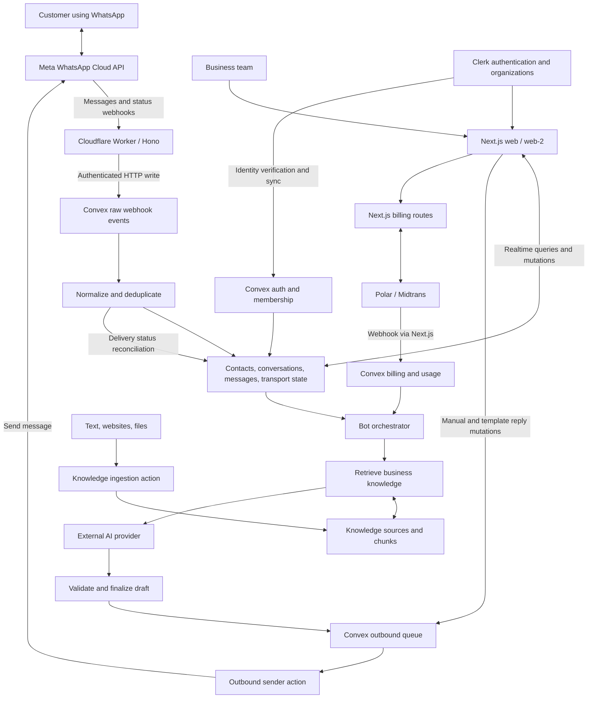
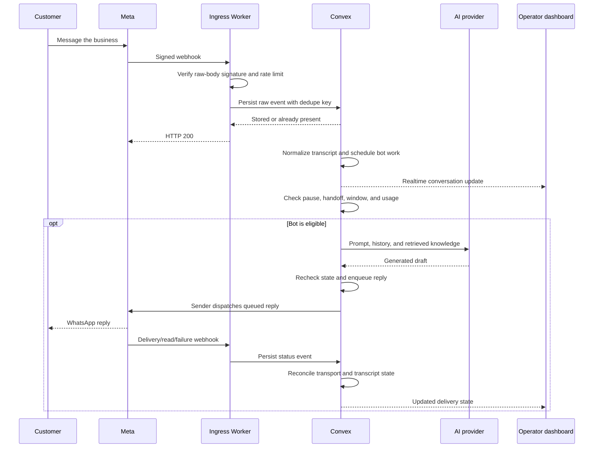

# Wabrix: Product, User Guide, and Architecture

Wabrix is a WhatsApp-first customer communication platform for businesses. It combines a configurable AI assistant, business knowledge, and a shared operator inbox so a team can automate routine replies and take over conversations when needed.

This document explains the product and the implementation present in this repository as inspected on 20 October 2026. It describes source behavior, not a certification of a live deployment. The earlier [product requirements](phase-0/prd.md) describe intent; where they differ from current code, the implementation details below take precedence.

## 1. The idea and why it exists

A business using WhatsApp for support or sales repeatedly answers questions about products, opening hours, pricing, and policies. As conversations increase, a single phone or a manual inbox makes it harder to respond consistently, share responsibility, and track unresolved requests.

Wabrix brings three things into one workspace:

- **Instructions:** how the business wants its assistant to behave.
- **Knowledge:** the information the assistant can retrieve when answering.
- **Operations:** the conversation history, people, delivery state, and controls needed to run customer support.

For example, a shop can upload its delivery and return policies, tell the assistant how to answer, and let it handle routine questions. An operator can pause the bot and handle an unusual return request in the same conversation. This is an intended workflow, not a claim about an existing customer.

The central product idea is that automation and human support share one conversation record. The customer continues using WhatsApp; the business works in Wabrix.

## 2. Who it is for

| Person | What they do |
| --- | --- |
| Business owner or workspace administrator | Set up the organization, configure the bot, connect WhatsApp, manage knowledge, and review billing. |
| Support or sales operator | Read conversations, reply, assign work, add internal notes, and manage handoff. |
| End customer | Message the business through WhatsApp without installing Wabrix. |

The intended audience includes businesses with recurring WhatsApp questions and teams that need a common inbox. English and Indonesian language handling and Polar/Midtrans billing paths support international and Indonesian use cases.

These are product personas. The current authorization code uses Clerk organization roles, particularly `org:admin` and `org:member`; it does not establish a complete separate owner/admin/agent/viewer permission model merely because those personas appear in planning documents.

## 3. How the product is designed

The workspace groups work by responsibility:

| Area | Purpose |
| --- | --- |
| Bot Configuration / Bot Studio | Set the assistant prompt, language, model settings, and credentials; try replies in the emulator. |
| Knowledge Base | Add business information and inspect whether it is ready for retrieval. |
| WhatsApp Integration | Configure credentials and webhook setup; manage templates and inspect lifecycle state. |
| Chat / Inbox | Read live conversations, send replies, pause automation, assign responsibility, and add notes. |
| Contacts | Inspect customers and their conversation context. |
| Billing and overview | Inspect subscription, usage, and operational summaries. |
| Workspaces and team | Select an organization and manage its team context. |

The interface uses Next.js and React with Tailwind CSS and shared or local UI components. Convex subscriptions keep conversation views synchronized with backend state. Authentication and organization selection use Clerk.

Two frontend applications exist: `apps/web` contains the earlier localized dashboard, while `apps/web-2` contains another dashboard and workspace interface using the same backend. The user routes below refer to `apps/web-2`; this does not establish which frontend is currently deployed. Template/demo pages in a frontend are not evidence of additional finished product capabilities.

## 4. How to use Wabrix

### Step 1: Sign in and choose a workspace

In the `web-2` interface, sign up at `/auth/sign-up` or sign in at `/auth/sign-in`. Open `/dashboard/workspaces` to create or select the organization that should own the bot, conversations, integration, and billing. Team management is available under `/dashboard/workspaces/team`.

Use an administrator account for configuration. Backend access depends on the active organization and its synchronized membership, so signing in alone does not grant access to another workspace's data.

### Step 2: Configure the assistant

Open `/bot-configurations` and save the bot configuration. Define the assistant's role, business instructions, preferred language, and generation settings. Configure the selected provider's credentials where required. The backend also supports a deployment-level Google key as a fallback for the Google provider.

A useful starting instruction is: “Answer questions using our business information. If the information is insufficient, say so and ask the customer for clarification.” Test representative questions in the emulator beside the configuration form. Emulator output checks drafting behavior; it does not prove that WhatsApp delivery is connected.

### Step 3: Add business knowledge

Open `/knowledge-base`. Add inline information, a website, or a supported file using the available source controls. Start with factual material such as service descriptions, opening hours, delivery terms, or FAQs.

Check the source's status after ingestion. Only ready, usable knowledge should be treated as available to the bot. File processing can return a deferred state; uploading a PDF does not guarantee successful extraction and embedding. Retest questions whose answers depend on the new material.

Knowledge retrieval supplies context to the model. It does not train a separate model or guarantee that every generated answer is correct.

### Step 4: Connect WhatsApp

Open `/whatsapp-integration`. Prepare the Meta phone number ID, WhatsApp Business account ID, access token, app secret, and verification token required by the configuration form.

Save the integration and configure the webhook URL shown by Wabrix in the corresponding Meta application. The ingress endpoint is `/webhooks/whatsapp`. The verification token and application secret must agree with the ingress deployment's configuration; an administrator may need the person operating that deployment to set those values.

Inspect webhook verification, connection, approval, and lifecycle information. Refresh or sync templates so the workspace reflects Meta's current approval state. A locally saved template is not proof of approval.

### Step 5: Test the complete conversation

Send a message from a customer WhatsApp account to the configured business number. Open `/chat` and confirm that the conversation and inbound message appear. Check that an eligible bot reply is generated, queued, sent, and updated by delivery status events.

If the reply is missing, inspect integration state, bot configuration, knowledge status, bot pause/handoff state, usage limits, service-window state, and queue errors. A visible generated message and a confirmed delivered message are different checkpoints.

### Step 6: Handle conversations as a team

Select a conversation in `/chat`. Review its history and details, assign it to an operator, and use internal notes to leave team context. Notes are separate from customer messages.

When a person should handle the conversation, pause the bot or request handoff before replying. Both states block new automatic bot work. Manual replies use the same durable outbound queue as bot replies. When returning the conversation to automation, clear the relevant pause/handoff controls.

The backend enforces a 24-hour service-window check for freeform replies. When the window is closed, use an approved template through the template reply controls. The sender checks eligibility again before dispatch, so a message can be blocked if the window expires while it is waiting.

### Step 7: Review usage and billing

Use `/dashboard/billing` to inspect the plan, usage, and checkout options. Billing code supports Polar and Midtrans, with country-aware routing. Successful checkout initiation is not the same as an active entitlement: provider events must reach the backend and update subscription state.

## 5. Architecture and component boundaries

| Component | Responsibility |
| --- | --- |
| Next.js frontends | Customer-facing website and authenticated business workspace; call backend functions and expose billing routes. |
| Clerk | Sign-in, organization context, and membership identity. |
| Cloudflare Worker with Hono | Verify Meta challenges/signatures, apply phone-number rate limits, and persist raw events before acknowledging accepted requests. |
| Convex | Application database, access checks, realtime queries, transactional mutations, scheduled work, and external-service actions. |
| AI provider | Generate text and, on the Google path, embeddings from supplied input. Application state and send decisions remain in Wabrix. |
| Meta | WhatsApp transport, template approval, and delivery status events. |
| Polar / Midtrans | Checkout and payment events; Wabrix maintains its own normalized subscription and usage state. |
| Optional object storage | Store processed inbound media when S3-compatible storage is configured. |

These are logical runtime components. Hosting accounts, production URLs, and deployment health are not verified by this document.

## 6. What happens when a customer sends a message

The ingress request never waits for AI generation. If durable persistence fails, the worker returns an error rather than acknowledging the event as stored. Processing then happens through Convex functions and scheduled work.

The orchestrator uses a 3.5-second debounce to collect closely spaced inbound activity. It checks whether the conversation is open, the bot is paused, handoff is requested, and the service window is open. The action checks AI usage before generation. Generation tokens and inbound-state checks prevent an outdated draft from being finalized as if it still answered the latest conversation state.

A generated draft becomes a transcript message and an outbound queue entry. The sender claims queue work, checks eligibility, calls Meta, and records success or failure. Retryable failures schedule backoff on the queue record; permanent failures remain visible for investigation. Queue deduplication reduces duplicate application work; it is not a guarantee of exactly-once delivery across external networks.

## 7. How knowledge and AI are implemented

Knowledge ingestion converts supported sources into Markdown, splits content into chunks, generates embeddings, and stores the source and chunks in Convex. Website extraction has a Jina Reader path, an optional Firecrawl path, and local HTML fallback. File conversion can be deferred when processing is unavailable.

At reply time, `orchestratorAction.ts` embeds the sanitized customer message, loads the organization's bot knowledge corpus, and selects chunks by cosine similarity. The current selection uses up to four chunks with a minimum score of 0.2. This is application-level similarity selection over stored embeddings, not evidence of a separate vector database service.

The model receives the configured system prompt, conversation history, the latest message, and retrieved context. The runtime records information such as selected model, prompt version, token usage, estimated cost, and guardrail signals. Prompt-injection checks are a guardrail, not a proof that arbitrary customer input is safe.

Google is the primary implemented provider path, with an additional `digitalocean_reference` configuration path. Inspect the active workspace settings to determine the actual selected model; provider dependencies alone do not establish a working integration.

## 8. Data model, access, and reliability

| Data group | Main records |
| --- | --- |
| Identity and tenancy | `users`, `organizations`, `orgMembers`, `auditLogs` |
| Bot configuration and runs | `botProfiles`, `modelProviderSettings`, `promptVersions`, `aiRuns` |
| Business knowledge | `knowledgeSources`, `knowledgeChunks`, `knowledgeUsageLogs` |
| WhatsApp integration | `whatsappIntegrations`, `whatsappWebhookEvents`, `whatsappTemplates`, lifecycle and sync logs |
| Customer conversations | `whatsappContacts`, `conversations`, `messages`, `conversationNotes` |
| Transport and delivery | `whatsappMessages`, `whatsappMedia`, `outboundQueue` |
| Billing and operations | `plans`, `subscriptions`, `usageCounters`, `billingEvents`, notifications and push subscriptions |

Transcript messages represent conversation content; transport records represent WhatsApp delivery details. Keeping them linked but separate lets the inbox show a message while delivery is still queued or has failed.

Backend access resolves the authenticated Clerk subject, active organization claim, and stored membership. Functions check role and organization ownership where required. For example, inbox write actions require `org:member` with an admin override, while knowledge ingestion requires `org:admin`. Product personas should not be mistaken for additional implemented permission tiers.

Credentials have encrypted storage paths, and ingress-to-Convex forwarding uses a shared secret. Raw-event keys and queue idempotency keys support deduplication. The current outbound key helper returns `whatsapp:<messageId>`; this differs from the older architecture proposal's integration/message key example.

## 9. Where the implementation lives

| Path | What to inspect |
| --- | --- |
| [`apps/web-2/src/app`](../apps/web-2/src/app) and [`features`](../apps/web-2/src/features) | Workspace routes, chat UI, bot configuration, knowledge, integrations, and billing. |
| [`apps/web`](../apps/web) | Earlier localized frontend and its tests. |
| [`apps/ingress/src/index.ts`](../apps/ingress/src/index.ts) | Webhook challenge, signature verification, rate limiting, and durability response. |
| [`packages/backend/convex/http.ts`](../packages/backend/convex/http.ts) | Backend HTTP integration entry points. |
| [`schema.ts`](../packages/backend/convex/schema.ts) and [`rbac.ts`](../packages/backend/convex/rbac.ts) | Stored data model and organization access resolution. |
| [`whatsappWebhookEvents.ts`](../packages/backend/convex/whatsappWebhookEvents.ts) and [`inbound.ts`](../packages/backend/convex/inbound.ts) | Raw event processing and conversation normalization. |
| [`orchestrator.ts`](../packages/backend/convex/orchestrator.ts) and [`orchestratorAction.ts`](../packages/backend/convex/orchestratorAction.ts) | Eligibility, debounce, draft generation, and finalization. |
| [`knowledgeActions.ts`](../packages/backend/convex/knowledgeActions.ts) and [`lib/knowledge.ts`](../packages/backend/convex/lib/knowledge.ts) | Ingestion, embeddings, and retrieval helpers. |
| [`inbox.ts`](../packages/backend/convex/inbox.ts) | Inbox queries, assignment, handoff, notes, and reply mutations. |
| [`outbound.ts`](../packages/backend/convex/outbound.ts) and [`outboundAction.ts`](../packages/backend/convex/outboundAction.ts) | Queue claims, retries, provider calls, and delivery reconciliation. |
| [`billing.ts`](../packages/backend/convex/billing.ts) | Subscription state, normalized payment events, and usage guards. |
| [`mediaAction.ts`](../packages/backend/convex/mediaAction.ts) | Media downloads and optional downstream processing/storage. |

The repository uses TypeScript, pnpm workspaces, and Turborepo. See [Local Setup](local-setup.md) and the [root README](../README.md) for environment configuration. The package scripts start `apps/web` on port 3000 and `apps/web-2` on port 3001; ingress normally uses port 8787. Convex development runs separately from the backend package.

## 10. Design trade-offs and practical limits

Persisting webhooks before acknowledgment adds a backend dependency to ingestion, but avoids treating an unstored event as accepted. Asynchronous generation keeps webhook latency independent of model latency. A shared send queue centralizes policy checks and retries for both people and bots.

Convex provides database, realtime, and scheduling primitives in one backend, reducing the number of independently operated services while coupling the implementation to its runtime and data model. Loading a knowledge corpus and ranking it in application code is straightforward, but its latency and cost need reassessment as knowledge grows.

The knowledge base can improve grounding, but source quality and model behavior still affect answers. The emulator checks AI behavior, while a real WhatsApp test checks credentials, ingestion, generation, transport, and reconciliation together. Billing, media processing, and optional observability depend on configured external services. Existing source and test files do not establish production readiness, live customer usage, or successful deployment.
